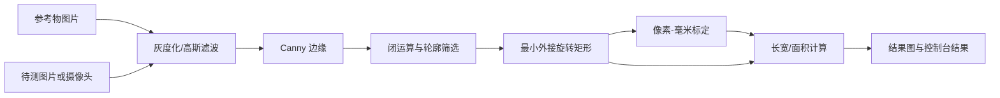

# OpenCV 工件尺寸测量

一个面向工业视觉入门的传统机器视觉项目：使用已知尺寸的参考物完成像素标定，通过边缘检测、形态学处理和旋转最小外接矩形，测量图像中的工件长宽和面积，并支持图片结果导出与摄像头实时显示。

## 项目亮点

- **标定可解释**：`px/mm = 参考物像素长度 / 参考物实际长度`，不依赖训练数据。
- **适配旋转工件**：使用 `cv2.minAreaRect`，不要求工件与图像坐标轴平行。
- **工程化入口**：命令行参数、输入校验、异常提示、结果图保存、摄像头资源释放齐全。
- **轻量部署**：仅依赖 Python、NumPy 和 OpenCV，不需要 GPU。

## 流程



### 用参考图标定并测量图片

```bash
python measure.py --reference-image 参照物.png --reference-mm 30 --image 累死我了.png --output outputs/result.jpg
```

参考图中面积最大的轮廓会作为参考物。实际使用时，参考物和工件应保持在同一平面，摄像头高度、焦距和光照尽量固定。

### 已经知道标定结果时

```bash
python measure.py --pixel-per-mm 12.5 --image 累死我了.png --output outputs/result.jpg
```

### 摄像头实时测量

```bash
python measure.py --pixel-per-mm 12.5 --camera 0
```

按 `q` 退出。背景越纯、光线越均匀，轮廓越稳定；`--min-area 1500` 可过滤更小的噪声轮廓。

## 验证

```bash
python -m unittest -v
```

测试使用合成矩形验证轮廓检测和像素标定，避免依赖摄像头或特定硬件。

## 指标与边界

这是一个**非深度学习测量系统**，因此没有 Precision、Recall、mAP、混淆矩阵或模型大小等训练指标。建议在自己的工件数据上记录以下更匹配的指标：

| 指标 | 定义 |
|---|---|
| 检测成功率 | 成功输出目标框的图片数 / 总图片数 |
| 长度 MAE | `mean(abs(预测长度 - 卡尺长度))`，单位 mm |
| 相对误差 | `abs(预测 - 真值) / 真值` |
| 处理速度 | 单张图片平均延迟与摄像头 FPS |

已知限制：单目平面标定无法消除透视误差；反光、阴影、粘连目标和复杂背景会影响边缘轮廓。生产环境应增加棋盘格/平面单应性标定、固定光源、相机支架以及多目标跟踪或实例分割。

## 简历写法（把占位数据换成实测值）

**OpenCV 工件尺寸测量｜Python / OpenCV / NumPy**

- 设计“参考物标定—边缘提取—形态学去噪—轮廓筛选—旋转外接矩形—尺寸换算”的完整测量流程，支持静态图片与摄像头实时测量。
- 使用 `minAreaRect` 处理任意旋转工件，输出长宽、面积、可视化结果图；在自建 **[N]** 张工件图片上达到 **[X]%** 检测成功率，长度 MAE **[Y] mm**，单张延迟 **[Z] ms**。
- 针对阴影、反光、透视变化等失败案例分析误差来源，并通过固定工作距离、柔光和最小轮廓面积阈值提升稳定性。

## 文件说明

- `measure.py`：项目主程序，包含检测、标定、测量、可视化和摄像头入口。
- `test_measure.py`：最小可运行自检。
- `size_measurement_based_on_OpenCV.py`：原始教学脚本，保留用于对照历史实现。
